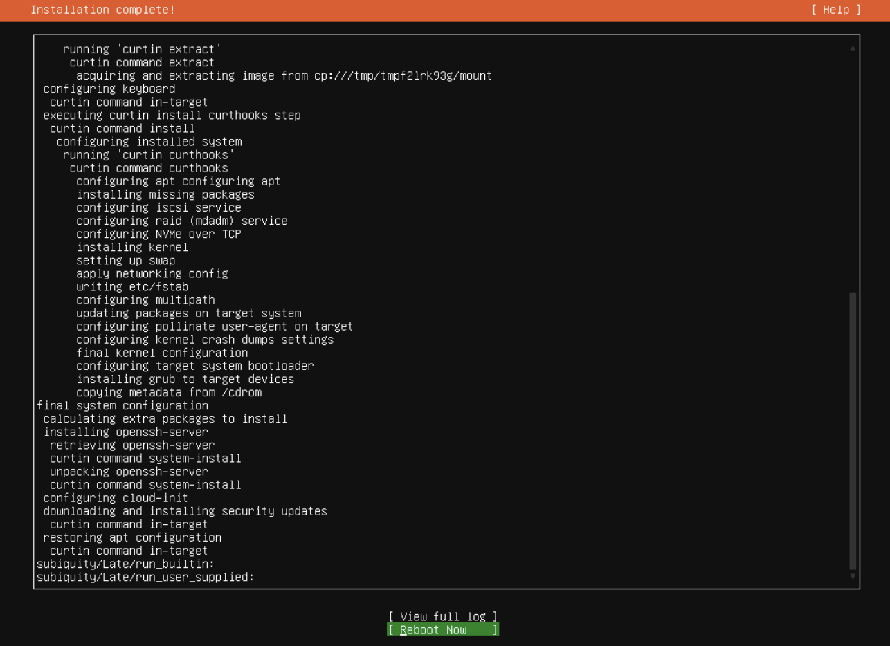
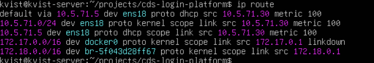
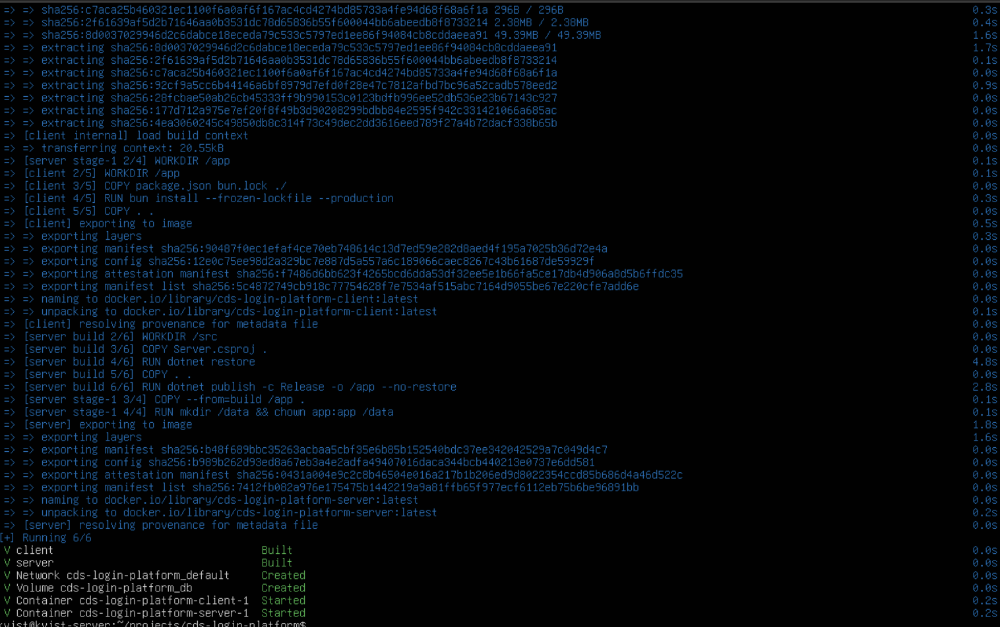
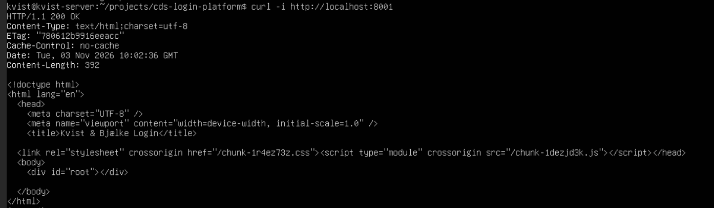
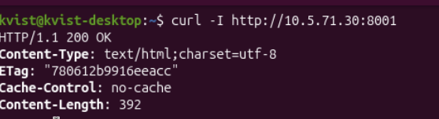
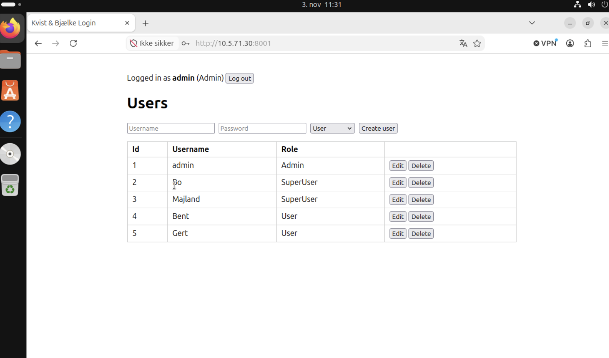

### Lab

#### Server

| Setting | Value                   |
|---|-------------------------|
| Operating system | Ubuntu Server           |
| IP address | `10.5.71.10/24`, static |
| Gateway | `10.5.71.1`             |
| App port | **TCP 8001**            |

**Setting up the server**
```bash
apt-get update
apt-get install -y docker.io docker-compose-v2
git clone https://github.com/majlando/cds-login-platform
systemctl enable --now docker
docker compose up -d --build
docker compose ps
```

#### Client
**Setup client on VLAN 570 (Ubuntu Desktop)**

- Address: x.x.x.x
- Netmask: x.x.x.x
- Gateway: x.x.x.x

### Testing

Take screenshots of these

#### Server

- ip a
- ip route
- sudo docker compose ps
- curl -I http://localhost:8001/


#### Client

- ip a
- ip route
- curl -I http://x.x.x.x:8081/
- Open http://x.x.x.x:8001/ in browser

| **Ubuntu Server installed** | **Server IP settings**                               |
|---|--------------------------------------------------------------|
|  |         |
| **Docker and the app running** | **App answers on the server**                        |
|  |  |
| **Client IP settings** | **Tests from the client**                                    |
|  |              |
| **App used from the client** |                                                              |
|  |       