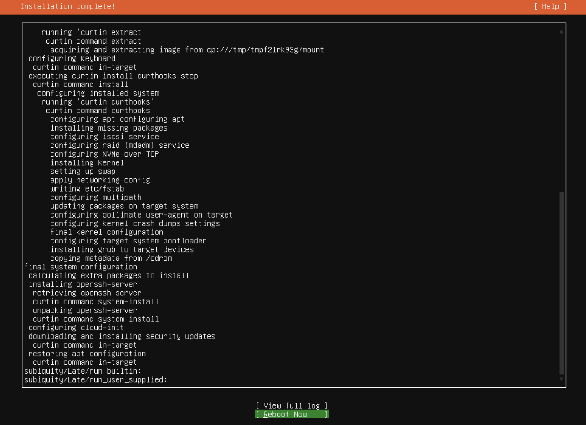
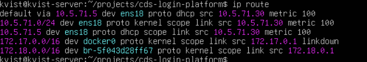
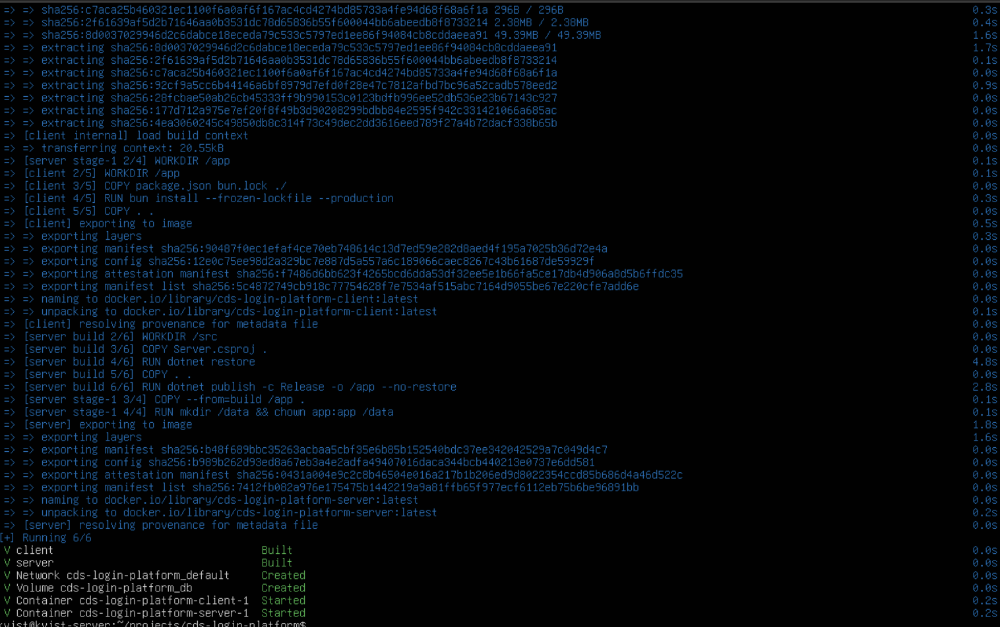
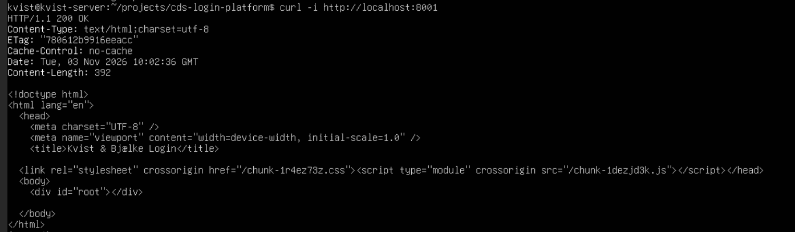
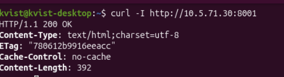
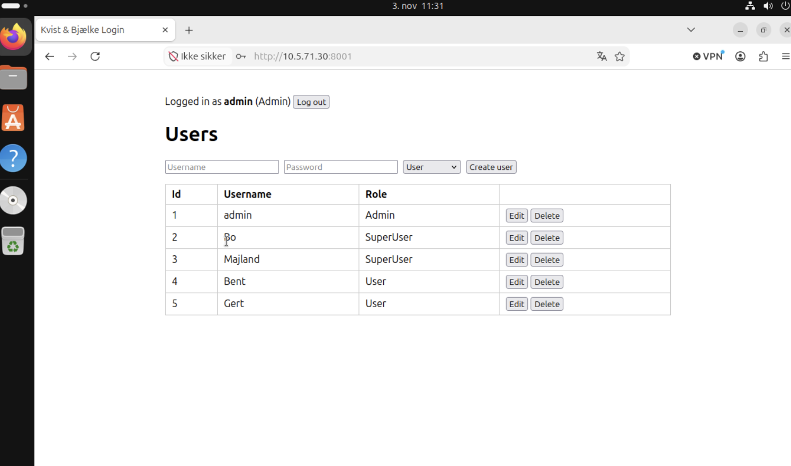

# SDS.infrastucture

*Merged with README.md when completed*

### IP adressing plan
- Each VLAN has its own subnet
- VLAN 5xx uses 10.5.xx.0 (for example VLAN 570 uses 10.5.70.0)
- Gateway is x.x.x.1

| VLAN | Name | Network | Subnet Mask     | Gateway | Devices possible | Devices today                    | 
|---|---|---|-----------------|---|-----------------:|----------------------------------|
| **570** | Clients | `10.5.70.0/24` | 255.255.255.0   | 10.5.70.1 |              254 | 15 desktops, 10 laptops (dhcp)   |
| **571** | Servers | `10.5.71.0/24` | 255.255.255.0   | 10.5.71.1 |              254 | 3 servers (static)               | 
| 572 | Voice | `10.5.72.0/26` | 255.255.255.192 | 10.5.72.1 |               62 | 12 IP phones (dhcp)              |
| 573 | Printers | `10.5.73.0/28` | 255.255.255.240 | 10.5.73.1 |               14 | 3 printers (static)              |
| 574 | Surveillance | `10.5.74.0/27` | 255.255.255.224 | 10.5.74.1 |               30 | 6 cameras (static)               |
| 575 | Guest Wi-Fi | `10.5.75.0/24` | 255.255.255.0   | 10.5.75.1 |              254 | Visitors (dhcp)                  |
| 576 | Management | `10.5.76.0/27` | 255.255.255.224 | 10.5.76.1 |               30 | Switches, access points (static) |

- Static: Used for servers, printers and network equipment.
- DHCP: Used for clients, phones and guests.

### Subnetting Examples

|                  | VLAN 570 – Clients | VLAN 573 – Printers | 
|------------------|---|---|
| Mask             | `10.5.70.0/24` = `255.255.255.0` | `10.5.73.0/28` = `255.255.255.240` | 
| Usable addresses | 2⁸ − 2 = **254** | 2⁴ − 2 = **14** |
| Devices          | 25 | 3 |

- **Clients /24:** Today we have 25 clients and this is likely to grow, so we leave room for 254 usable adresses
- **Printers /28:** Today we have 3 printers, so we leave room for 14 usable addresses.

### Lab

#### Server

| Setting | Value                   |
|---|-------------------------|
| Operating system | Ubuntu Server 24.04 LTS |
| IP address | `10.5.71.10/24`, static |
| Gateway | `10.5.71.1`             |
| App port | **TCP 8001**            |

**Setting up the server**
```bash
apt-get update
apt-get install -y docker.io docker-compose-v2
git clone https://github.com/majlando/cds-login-platform
systemctl enable --now docker
docker compose up -d --build
docker compose ps
```

#### Client
**Setup client on VLAN 570 (Ubuntu Desktop)**

- Address: x.x.x.x
- Netmask: x.x.x.x
- Gateway: x.x.x.x

### Testing

Take screenshots of these

#### Server

- ip a
- ip route
- sudo docker compose ps
- curl -I http://localhost:8001/


#### Client

- ip a
- ip route
- curl -I http://x.x.x.x:8081/
- Open http://x.x.x.x:8001/ in browser

| **Ubuntu Server installed** | **Server IP settings**                               |
|---|--------------------------------------------------------------|
|  |         |
| **Docker and the app running** | **App answers on the server**                        |
|  |  |
| **Client IP settings** | **Tests from the client**                                    |
|  |              |
| **App used from the client** |                                                              |
|  |                                                              |