# Kvist & Bjælke Login Platform

A simple login platform with user roles.

Made with:
- **React + TypeScript** + **Bun**
- **C# .NET** 
- **Docker**

**GitHub repository:** https://github.com/majlando/cds-login-platform

## Table of Contents

### *CDS.security*
1. [How it works](#how-it-works)
2. [How to run it](#how-to-run-it)
3. [How to run it (without Docker)](#how-to-run-it-without-docker)
4. [Roles](#roles)
5. [API](#api)
6. [Project structure](#project-structure)
7. [Security decisions](#security-decisions)
8. [Screenshots](#screenshots)

### *CDS.infrastructure*
9. [IP addressing plan](#ip-addressing-plan)
10. [Subnetting](#subnetting)
11. [Network diagram](#network-diagram)
12. [Firewall and VLANs](#firewall-and-vlans)
13. [Lab](#lab)
14. [Challenges](#challenges)

### *The final reflections*
15. [Final reflection](#final-reflection)


# CDS.security

## How it works

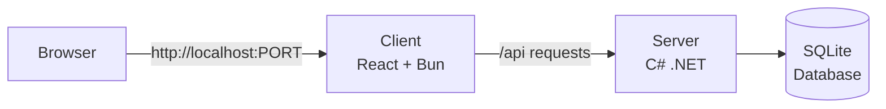

The project has two parts:

- **Client**: The website (React + TypeScript + Bun)
- **Server**: The backend (C# ASP.NET Core Web API + SQLite)

### Docker
- Each part runs in its own **Docker container**.
- **Docker Compose** starts both containers with one command.

## How to run it

You must install Docker and have it running. 

1. Create your `.env` file from the example, and change `JWT_KEY` and `SEED_PASSWORD`. The example values are public.

```bash
cp .env.example .env
```

2. Start Docker Compose

```bash
docker compose up -d --build
```

3. Open http://localhost:8001

**To stop**

```bash
docker compose down      # stop
```

```bash
docker compose down -v   # stop and delete the database
```

### Settings

Settings in `.env`:

| Setting         | What it does                                                           | Example     |
|-----------------|------------------------------------------------------------------------|-------------|
| `JWT_KEY`       | Random secret (at least 32 characters) used to sign login tokens       | Random text |
| `SEED_PASSWORD` | The password that users will have                                      | `password`  |
| `SEED_USERS`    | `true` will seed (create) demo users, `false` will only create `admin` | `true`      |

### Users

| Username | Role      | Created when      |
|----------|-----------|-------------------|
| admin    | Admin     | Always            |
| Bo       | SuperUser | `SEED_USERS=true` |
| Majland  | SuperUser | `SEED_USERS=true` |
| Bent     | User      | `SEED_USERS=true` |
| Gert     | User      | `SEED_USERS=true` |

## How to run it without Docker
(for development)

**Terminal 1**: start the server on http://localhost:5000

```bash
cd server
dotnet run
```

**Terminal 2**: start the website on http://localhost:3000

```bash
cd client
bun install
bun run dev
```

*The server will read [`server/appsettings.Development.json`](server/appsettings.Development.json) instead of `.env`.*

## Roles

| Role      | Can read users | Can create, update and delete |
|-----------|----------------|-------------------------------|
| User      | Yes            | No                            |
| SuperUser | Yes            | Users                         |
| Admin     | Yes            | Users, SuperUsers, Admins     |

## API

**Endpoints**

| Method   | Endpoint          | What it does   | Who can use it   |
|----------|-------------------|----------------|------------------|
| `POST`   | `/api/login`      | Log in         | Everyone         |
| `GET`    | `/api/users`      | List all users | All roles        |
| `POST`   | `/api/users`      | Create user    | SuperUser, Admin |
| `PUT`    | `/api/users/{id}` | Update user    | SuperUser, Admin |
| `DELETE` | `/api/users/{id}` | Delete user    | SuperUser, Admin |

To test the API, you can use `curl` or the browser.

Use port 3000 when not using Docker.

```bash
# Log in and get a token
curl -X POST http://localhost:8001/api/login \
  -H "Content-Type: application/json" \
  -d '{"username": "admin", "password": "password"}'

# Without a token (401 Unauthorized)
curl -i http://localhost:8001/api/users
```

## Project structure

```
client/src/
├── index.ts               Bun server
├── index.html             
├── main.tsx               
├── App.tsx                Shows the pages
├── api/api.ts             API
├── pages/LoginPage.tsx    Login form
├── pages/UsersPage.tsx    Users table
└── styles/index.css       Cascading Style Sheet

server/
├── Program.cs                       Startup
├── Controllers/AuthController.cs    POST /api/login
├── Controllers/UsersController.cs   POST, GET, PUT and DELETE /api/users
├── Models/User.cs                   User table and roles
├── Models/Dtos.cs                   Data Transfer Objects
└── Data/AppDbContext.cs             Database connection
```

## Security decisions

| Topic          | Decision                                                   |
|----------------|------------------------------------------------------------|
| Authentication | Username and password with a JWT that expires after 1 hour |
| Authorization  | Role is in JWT and checked on every request                |
| Passwords      | Stored as a hash, using PBKDF2 with a random salt          |
| Secrets        | Kept in `.env`, which is never committed to git            |

### Authentication

We use **JWT** (JSON Web Tokens)

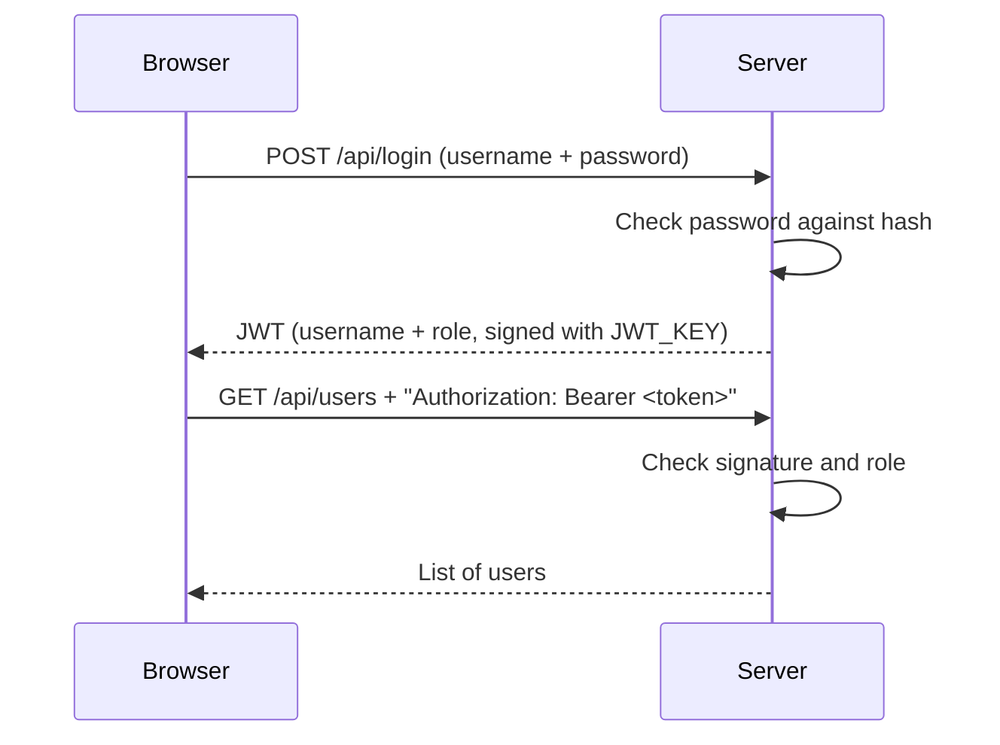

The Token is signed with **HMAC-SHA256**

- [`AuthController.cs`](server/Controllers/AuthController.cs) (create the token)
- [`Program.cs`](server/Program.cs) (check the token).

### Authorization

The server reads the role from the token on every request. 

You can see this in [`UsersController.cs`](server/Controllers/UsersController.cs)

- `[Authorize]` means you must be logged in.
- `[Authorize(Roles = "SuperUser,Admin")]` only these roles can create, update and delete.
- `CanManage` adds another rule: a SuperUser can only manage users with the User role. 

### Passwords

- Passwords are never stored as plaintext. We only store a **hash**.
- We use ASP.NET Core's built-in `PasswordHasher`. It uses an algorithm called **PBKDF2** (with HMAC-SHA512) together with a random **salt**:
  - Hashing 100,000 times makes it slow on purpose. Guessing passwords takes a very long time.
  - Salt is random data added to each password before hashing. Two users with the same password still get different hashes.
- When someone logs in, the password is compared with the stored hash.

Even if all five users have the same password, every hash will be different.

### Secrets

The JWT key and the password for the first users live in `.env`.

`.env` is in `.gitignore` so it is never committed to git.

[`.env.example`](.env.example) shows an example `.env`.

### Known limitations

- The Docker setup uses plain HTTP. On a real server we would use HTTPS, so that password and tokens can't be read by others on the network.
- A JWT can't be cancelled. If a user is deleted, their token still works until it expires (at most 1 hour).

### Alternatives

| Topic         | We use              | Alternative(s)       |                                                                                      |
|---------------|---------------------|----------------------|--------------------------------------------------------------------------------------|
| Password hash | PBKDF2              | Argon2id or bcrypt   | PBKDF2 is built into ASP.NET Core.                                                   |
| Login state   | JWT                 | Server-side sessions | JWT needs to storage on the server                                                   |
| Transport     | HTTP                | HTTPS                | HTTPS encrypts passwords and tokens on the network. It should be used in production. |

## Screenshots

<table>
  <tr>
    <td width="50%" valign="top">
      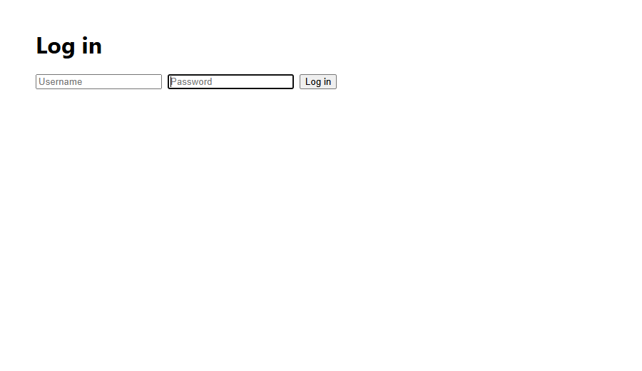
      <p><b>Login page.</b> Users log in with a username and password.</p>
    </td>
    <td width="50%" valign="top">
      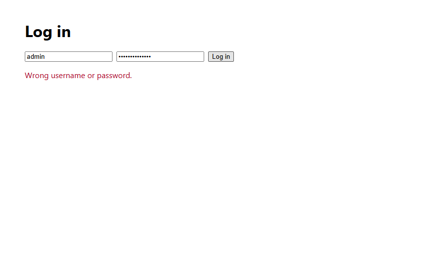
      <p><b>Wrong password.</b> A message is shown if the username or the password is wrong.</p>
    </td>
  </tr>
  <tr>
    <td width="50%" valign="top">
      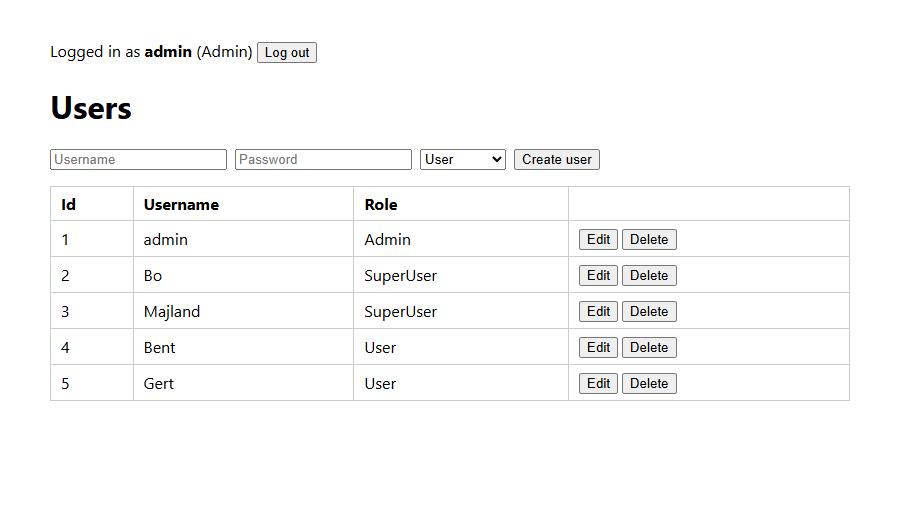
      <p><b>Logged in as Admin.</b> An Admin can create, edit or delete any user.</p>
    </td>
    <td width="50%" valign="top">
      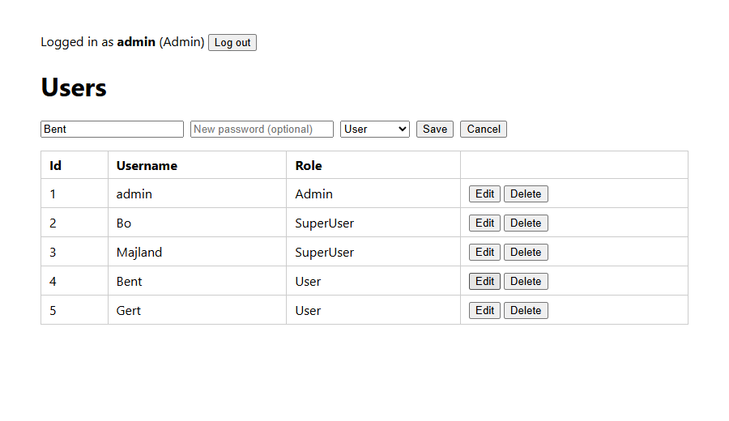
      <p><b>Admin editing a user.</b> Leaving the password empty keeps the old password.</p>
    </td>
  </tr>
  <tr>
    <td width="50%" valign="top">
      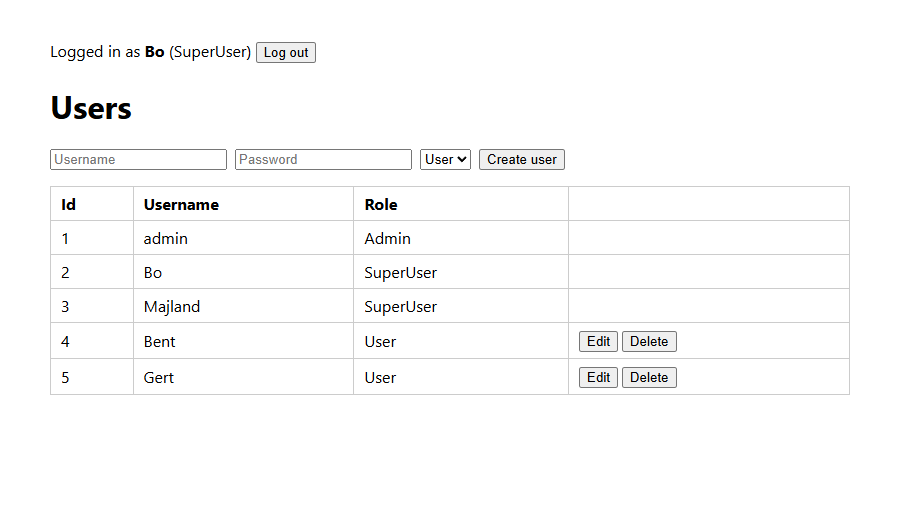
      <p><b>Logged in as SuperUser.</b> A SuperUser can only create, edit or delete users with the User role.</p>
    </td>
    <td width="50%" valign="top">
      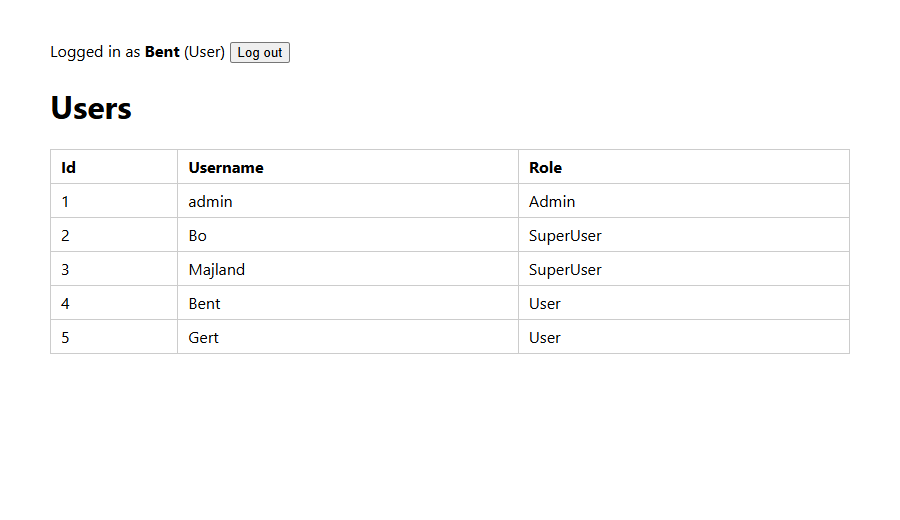
      <p><b>Logged in as User.</b> A User can only read the table.</p>
    </td>
  </tr>
  <tr>
    <td colspan="2">
      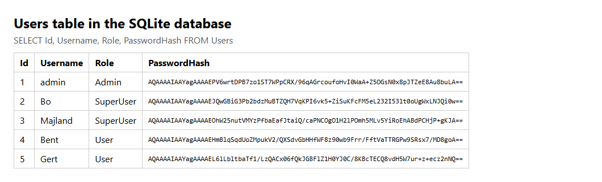
      <p><b>The database.</b> Only password hashes are stored, never the plaintext passwords. Even if all users have the same password, their hashes will be different because of the salt.</p>
    </td>
  </tr>
</table>

# CDS.infrastructure

## IP addressing plan

This is our proposal for the company's network. The lab differs in some places, as described below the table.

- Each VLAN has its own subnet
- VLAN 5xx uses 10.5.xx.0 (for example VLAN 570 uses 10.5.70.0)
- The proposed gateway is x.x.x.1

| VLAN | Name | Network | Subnet Mask     | Gateway | Devices possible | Devices today                    | 
|---|---|---|-----------------|---|-----------------:|----------------------------------|
| **570** | Clients | `10.5.70.0/24` | 255.255.255.0   | 10.5.70.1 |              254 | 15 desktops, 10 laptops (dhcp)   |
| **571** | Servers | `10.5.71.0/24` | 255.255.255.0   | 10.5.71.1 |              254 | 3 servers (static)               | 
| 572 | Voice | `10.5.72.0/26` | 255.255.255.192 | 10.5.72.1 |               62 | 12 IP phones (dhcp)              |
| 573 | Printers | `10.5.73.0/28` | 255.255.255.240 | 10.5.73.1 |               14 | 3 printers (static)              |
| 574 | Surveillance | `10.5.74.0/27` | 255.255.255.224 | 10.5.74.1 |               30 | 6 cameras (static)               |
| 575 | Guest Wi-Fi | `10.5.75.0/24` | 255.255.255.0   | 10.5.75.1 |              254 | Visitors (dhcp)                  |
| 576 | Management | `10.5.76.0/27` | 255.255.255.224 | 10.5.76.1 |               30 | Switches, access points (static) |

- Static: Used for servers, printers, cameras and network equipment.
- DHCP: Used for clients, phones and guests.

**In the lab:** The server on VLAN 571 gets `10.5.71.30` from DHCP, and its gateway is `10.5.71.5`. This comes from the existing lab network and differs from the proposal above.

### Why the network is segmented

We don't put all devices on the same network, because they have different security needs:

The devices is not on the same network, because they have different security needs.
- If one device is compromised, the attacker can't directly reach devices in other VLANs.
- Visitors' devices are not trusted, so they only get internet access.
- Servers are separated from clients, so access can be limited to the ports that are needed.
- Voice has its own VLAN, so it is easier to prioritize calls over other traffic.
- Switches and access points can only be configured from their own network.

## Subnetting

|                  | VLAN 570 – Clients | VLAN 573 – Printers | 
|------------------|---|---|
| Mask             | `10.5.70.0/24` = `255.255.255.0` | `10.5.73.0/28` = `255.255.255.240` | 
| Usable addresses | 2⁸ − 2 = **254** | 2⁴ − 2 = **14** |
| Devices          | 25 | 3 |

- **Clients /24:** Today we have 25 clients and this is likely to grow, so we leave room for 254 usable addresses.
- **Printers /28:** Today we have 3 printers, so we leave room for 14 usable addresses.

## Firewall and VLANs

**Why are VLAN 570 and VLAN 571 separate networks?** 
- Clients and servers have different security needs.
**What is the role of the firewall?** 
- The firewall sits between the networks and decides which traffic is allowed. 
- Here it allows VLAN 570 to reach VLAN 571 on TCP ports 8000–8100.
**Why allow only specific ports?** 
- Every open port is a possible way in.

## Lab

### Ubuntu Server 10.5.71.30

**Port choice: 8001**

The firewall only allows TCP ports 8000–8100 from VLAN 570 to VLAN 571, so the port must be in that range. 
We chose 8001.

**Setting up the server**
```bash
sudo apt-get update
sudo apt-get install -y docker.io docker-compose-v2
sudo systemctl enable --now docker
git clone https://github.com/majlando/cds-login-platform
cd cds-login-platform
cp .env.example .env
sudo docker compose up -d --build
sudo docker compose ps
```

**Ubuntu Server installed**

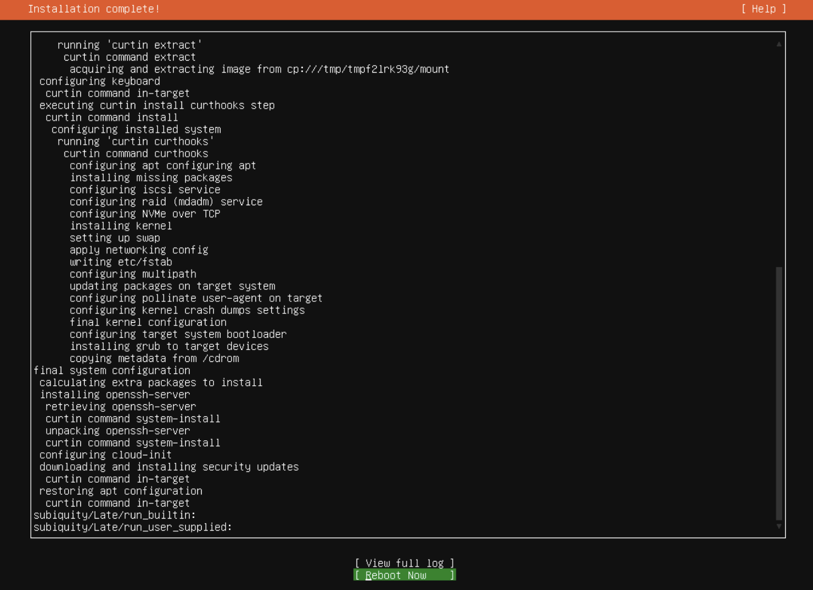

**Server IP**

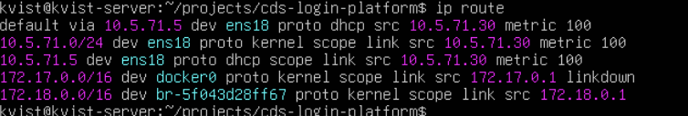

**docker compose up -d --build**

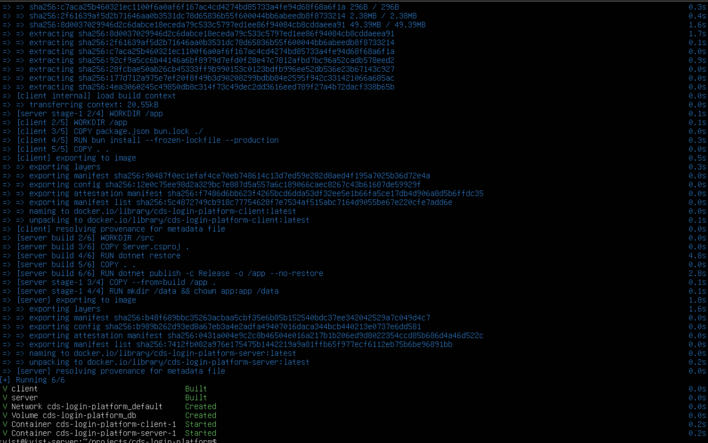

**App running on server**

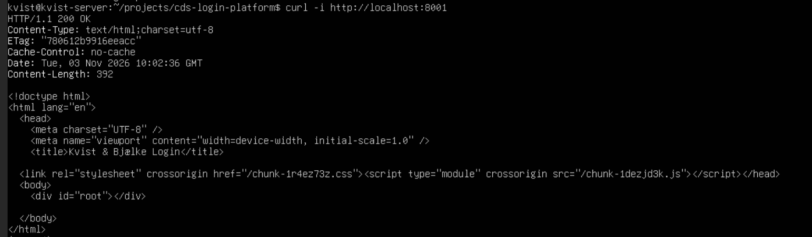


### Client

**Installing Ubuntu Desktop 26.04 LTS**

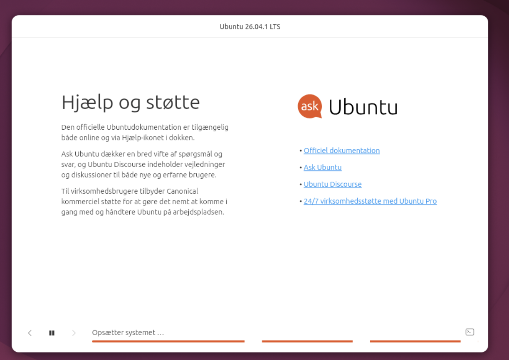

**Client IP configuration**

| Setting         | Value                    |
|-----------------|--------------------------|
| Hostname        | `kvist-desktop`          |
| Operating system| Ubuntu Desktop 26.04 LTS |
| VLAN            | 570          |
| Network         | `10.5.70.0/24`           |
| Subnet mask     | `255.255.255.0`          |
| Login platform  | `http://10.5.71.30:8001` |

**Client curl**

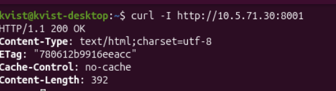

**App running in client**

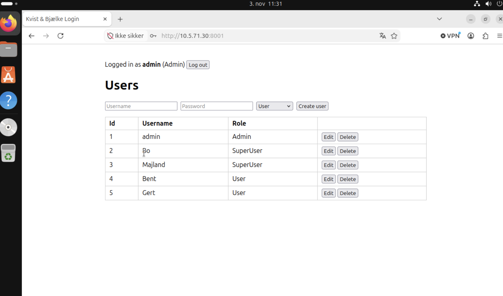


## Challenges

| Challenge | How we resolved it |
|---|---|
| The virtual machine was very slow, and it was hard to enter commands. | We prepared the setup commands in a short list and ran them one at a time. |
| Docker Compose wouldn't start on the server, because `.env` isn't in git and `JWT_KEY` was missing. | We created `.env` on the server from `.env.example`. |
| The server's gateway is `10.5.71.5`, not `10.5.71.1` as in our IP plan. The server also gets its address from DHCP, while the plan uses static addresses for servers. | We checked the real configuration with `ip route` and kept the settings from the lab network. Our IP plan is a proposal for the company's network. |
| We needed to test the connection between the VLANs | We tested from the client with `curl` to `10.5.71.30:8001` and then opened the login platform in a browser. |

# Final reflection

### How are security and infrastructure interconnected?
- It is important that both the app and infrastructure are secure, because a hacker can exploit the weakest link.
- Password is hashed, but we are using plain HTTP, so others on the network can read passwords.
- The infrastructure should be designed with security in mind from the start.

### What technical challenges did you encounter?
- The Virtual Machine was extremely slow, we could hardly enter any commands.
- The Docker deployment didn't go as smoothly as it could have.
- The network configuration was more complex than expected.

### What did you learn about deploying an application on a server?

- Docker Compose allows to deploy multiple containers with a single command.
- We had to create a new .env because it wasn't commited to git.
- `.env.example` shows which settings are needed, but its values must be changed, because the repository is public.

### What would you do differently in a real company?

- On a real server we would use HTTPS, so that passwords and tokens are encrypted.
- Make it possible for users to create their own accounts, instead of having a shared password.
- Add backup, monitoring and logging.
- Narrow the firewall rule from TCP ports 8000–8100 to only the port the login platform uses.
