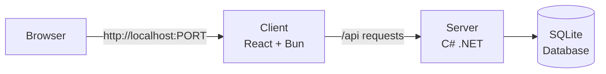
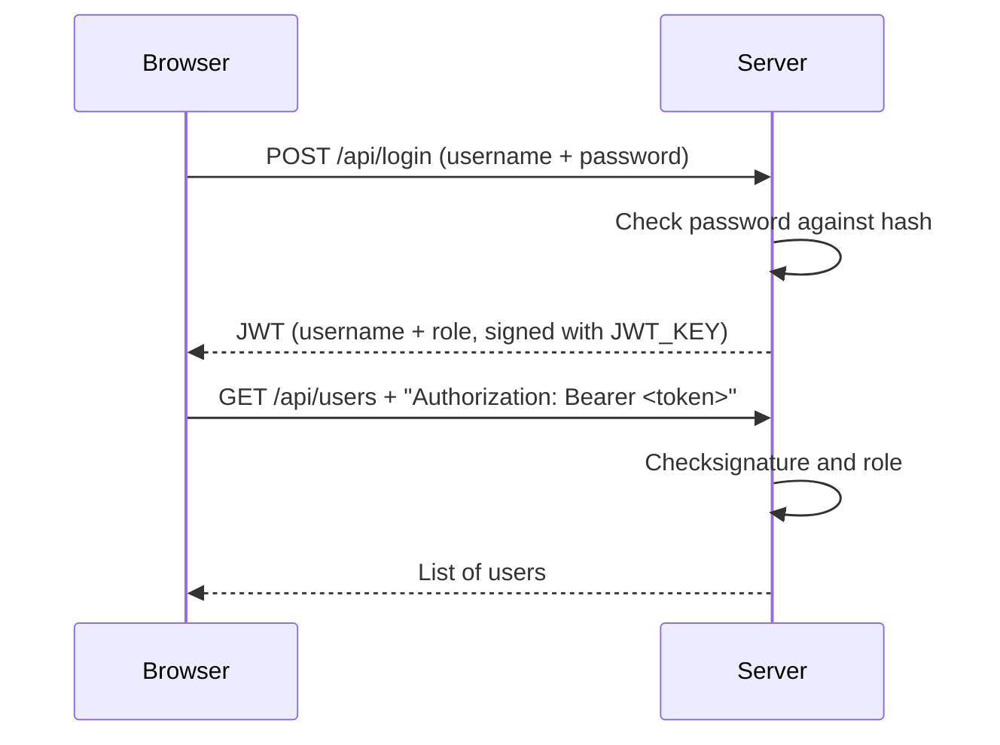
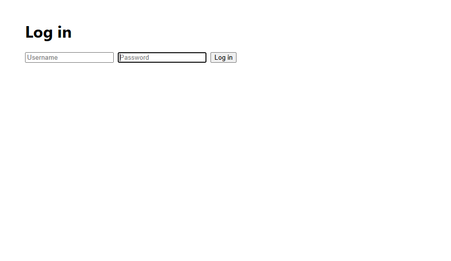
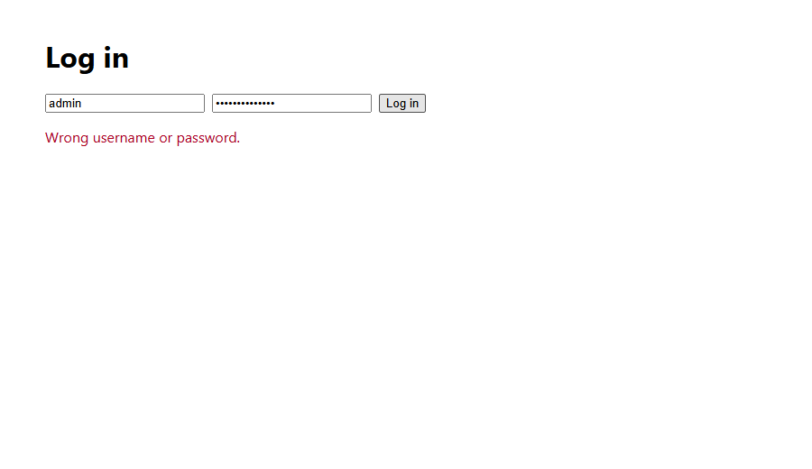
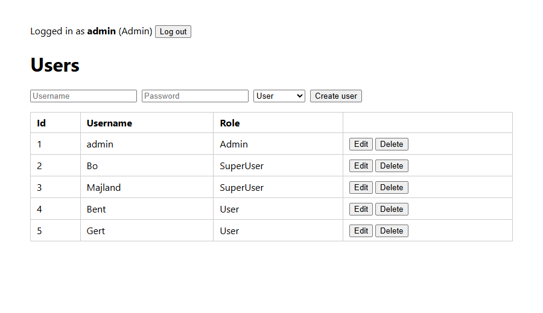
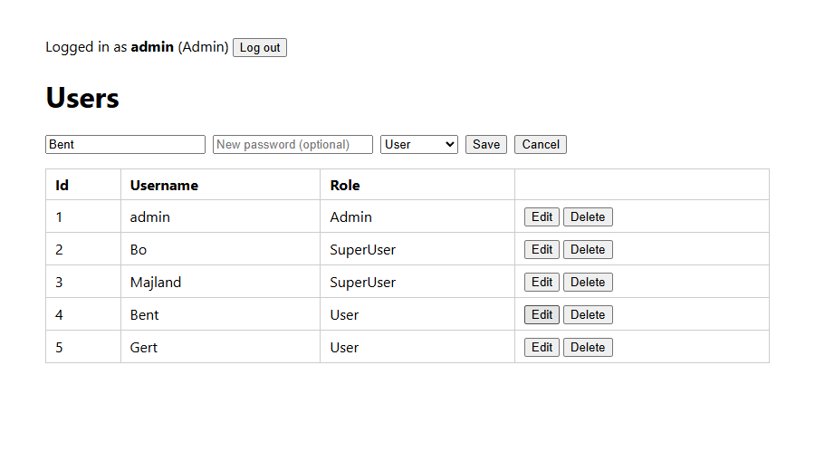
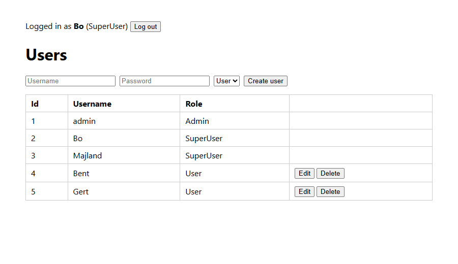
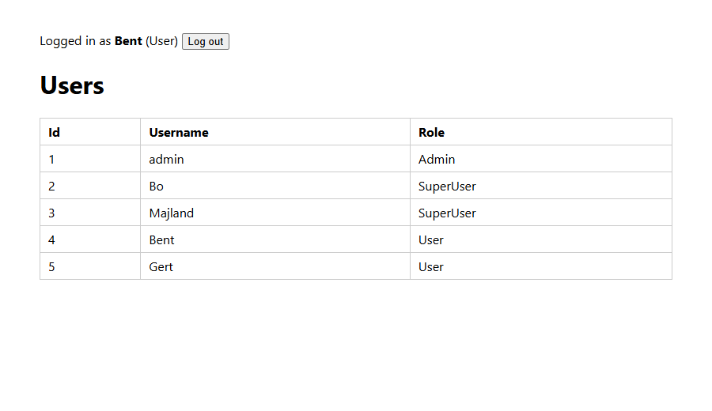
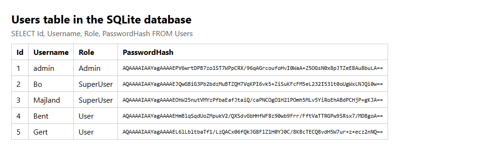

# Kvist & Bjælke Login Platform

A simple login platform with user roles.

Made with:
- **React + TypeScript** + **Bun**
- **C# .NET** 
- **Docker**

## Table of Contents

### *CDS.security*
1. [How it works](#how-it-works)
2. [How to run it](#how-to-run-it)
3. [How to run it (without Docker)](#how-to-run-it-without-docker)
4. [Roles](#roles)
5. [API](#api)
6. [Project structure](#project-structure)
7. [Security decisions](#security-decisions)
8. [Screenshots](#screenshots)

### *CDS.infrastructure*

### *Final reflection*

# CD.security

## How it works



The project has two parts:

- **Client**: The website (React + TypeScript + Bun)
- **Server**: The backend (C# ASP.NET Core Web API + SQLite)

### Docker
- Each part runs in its own **Docker container**.
- **Docker Compose** starts both containers with one command.

## How to run it

You must install Docker and have it running. 

1. Create your `.env` file from the example

```bash
cp .env.example .env
```

2. Start Docker Compose

```bash
docker compose up -d --build
```

3. Open http://localhost:8001

**To stop**

```bash
docker compose down      # stop
```

```bash
docker compose down -v   # stop and delete the database
```

### Settings

Settings in `.env`:

| Setting         | What it does                                                           | Example     |
|-----------------|------------------------------------------------------------------------|-------------|
| `JWT_KEY`       | Random secret (at least 32 characters) used to sign login tokens       | Random text |
| `SEED_PASSWORD` | The password that users will have                                      | `password`  |
| `SEED_USERS`    | `true` will seed (create) demo users, `false` will only create `admin` | `true`      |

### Users

| Username | Role      | Created when      |
|----------|-----------|-------------------|
| admin    | Admin     | Always            |
| Bo       | SuperUser | `SEED_USERS=true` |
| Majland  | SuperUser | `SEED_USERS=true` |
| Bent     | User      | `SEED_USERS=true` |
| Gert     | User      | `SEED_USERS=true` |

## How to run it without Docker (for development)

**Terminal 1**: start the server on http://localhost:5000

```bash
cd server
dotnet run
```

**Terminal 2**: start the website on http://localhost:3000

```bash
cd client
bun install
bun run dev
```

> [!NOTE]
> The server will read [`server/appsettings.Development.json`](server/appsettings.Development.json) instead of `.env`.

## Roles

| Role      | Can read users | Can create, update and delete |
|-----------|----------------|-------------------------------|
| User      | Yes            | No                            |
| SuperUser | Yes            | Users                         |
| Admin     | Yes            | Users, SuperUsers, Admins     |

## API

**Endpoints**

| Method   | Endpoint          | What it does   | Who can use it   |
|----------|-------------------|----------------|------------------|
| `POST`   | `/api/login`      | Log in         | Everyone         |
| `GET`    | `/api/users`      | List all users | All roles        |
| `POST`   | `/api/users`      | Create user    | SuperUser, Admin |
| `PUT`    | `/api/users/{id}` | Update user    | SuperUser, Admin |
| `DELETE` | `/api/users/{id}` | Delete user    | SuperUser, Admin |

To test the API, you can use `curl` or the browser.

Use port 3000 when not using Docker.

```bash
# Log in and get a token
curl -X POST http://localhost:8001/api/login \
  -H "Content-Type: application/json" \
  -d '{"username": "admin", "password": "password"}'

# Without a token (401 Unauthorized)
curl -i http://localhost:8001/api/users
```

## Project structure

```
client/src/
├── index.ts               Bun server
├── index.html             
├── main.tsx               
├── App.tsx                Shows the pages
├── api/api.ts             API
├── pages/LoginPage.tsx    Login form
├── pages/UsersPage.tsx    Users table
└── styles/index.css       Cascading Style Sheet

server/
├── Program.cs                       Startup
├── Controllers/AuthController.cs    POST /api/login
├── Controllers/UsersController.cs   POST, GET, PUT and DELETE /api/users
├── Models/User.cs                   User table and roles
├── Models/Dtos.cs                   Data Transfer Objects
└── Data/AppDbContext.cs             Database connection
```

## Security decisions

| Topic          | Decision                                                   |
|----------------|------------------------------------------------------------|
| Authentication | Username and password with a JWT that expires after 1 hour |
| Authorization  | Role is in JWT and checked on every request                |
| Passwords      | Stored as a hash, using PBKDF2 with a random salt          |
| Secrets        | Kept in `.env`, which is never committed to git            |

### Authentication

We use **JWT** (JSON Web Tokens)



The Token is signed with **HMAC-SHA256**

- [`AuthController.cs`](server/Controllers/AuthController.cs) (create the token)
- [`Program.cs`](server/Program.cs) (check the token).

### Authorization

The server reads the role from the token on every request. 

You can see this in [`UsersController.cs`](server/Controllers/UsersController.cs)

- `[Authorize]` means you must be logged in.
- `[Authorize(Roles = "SuperUser,Admin")]` only these roles can create, update and delete.
- `CanManage` adds another rule: a SuperUser can only manage users with the User role. 

### Passwords

- Passwords are never stored as plaintext We only store a **hash**.
- We use ASP.NET Core's built-in `PasswordHasher`. It uses an algorithm called **PBKDF2** (with HMAC-SHA512) together with a random **salt**:
  - Hashing 100,000 times makes it slow on purpose. Guessing passwords takes a very long time.
  - Salt is random data added to each password before hashing. Two users with the same password still get different hashes.
- When someone logs in, the password is compared with stored hash.

Even if all five users have the same password, every hash will be different.

### Secrets

The JWT key and the password for the first users live in `.env`.

`.env` is in `.gitignore` so it is never committed to git.

[`.env.example`](.env.example) shows an example `.env`.

### Known limitations

- The Docker setup uses plain HTTP. On a real server we would use HTTPS, so that password and tokens can't be read by others on the network.
- A JWT can't be cancelled. If a user is deleted, their token still works until it expires (at most 1 hour).

## Screenshots

<table>
  <tr>
    <td width="50%" valign="top">
      
      <p><b>Login page.</b> Users log in with a username and password.</p>
    </td>
    <td width="50%" valign="top">
      
      <p><b>Wrong password.</b> A message is shown if the username or the password is wrong.</p>
    </td>
  </tr>
  <tr>
    <td width="50%" valign="top">
      
      <p><b>Logged in as Admin.</b> An Admin can create, edit or delete any user.</p>
    </td>
    <td width="50%" valign="top">
      
      <p><b>Admin editing a user.</b> Leaving the password empty keeps the old password.</p>
    </td>
  </tr>
  <tr>
    <td width="50%" valign="top">
      
      <p><b>Logged in as SuperUser.</b> A SuperUser can only create, edit or delete users with the User role.</p>
    </td>
    <td width="50%" valign="top">
      
      <p><b>Logged in as User.</b> A User can only read the table.</p>
    </td>
  </tr>
  <tr>
    <td colspan="2">
      
      <p><b>The database.</b> Only password hashes are stored, plain text. Even if all users have the same password, their hashes will be different because of the salt.</p>
    </td>
  </tr>
</table>

## CDS.infrastructure

[TODO]

## Final reflection

[TODO]