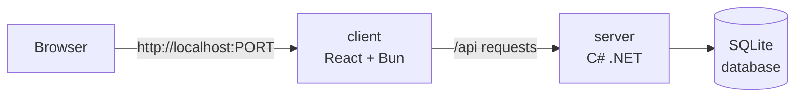
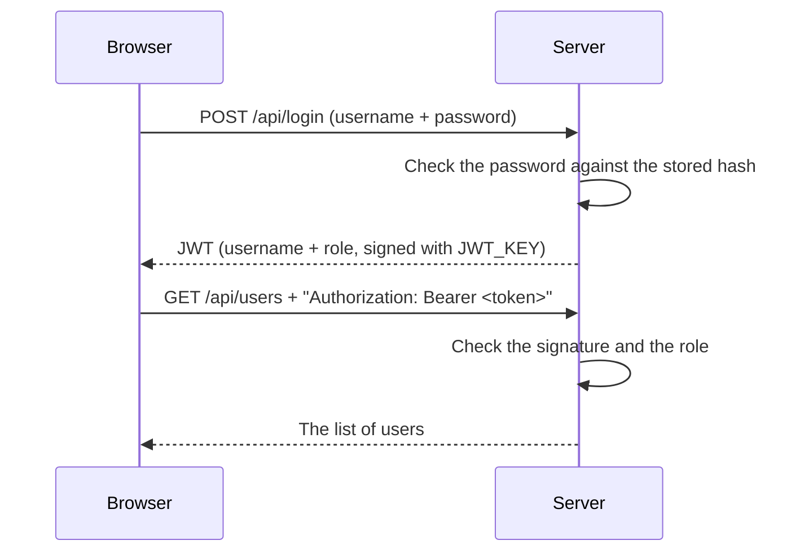

# Kvist & Bjælke Login Platform

A simple login platform with user roles.

Made with:
- **React + TypeScript** + **Bun**
- **C# .NET** 
- **Docker**

## Contents

### CDS.security
1. [How it works](#how-it-works)
2. [How to run it](#how-to-run-it)
   - [Settings](#settings)
   - [Users](#users)
3. [How to run it without Docker](#how-to-run-it-without-docker)
4. [Roles](#roles)
5. [The API](#the-api)
6. [Project structure](#project-structure)
7. [Security decisions](#security-decisions)
   - [Authentication: who are you?](#authentication-who-are-you)
   - [Authorization: what are you allowed to do?](#authorization-what-are-you-allowed-to-do)
   - [Passwords](#passwords)
   - [Secrets](#secrets)
   - [Known limitations](#known-limitations)
8. [Screenshots](#screenshots)
9. [Glossary](#glossary)

### CDS.infrastructure

[TODO]

### Final Reflection

[TODO]

# CD.security

## How it works



The project has two parts:

- **client** is the website, written in React and TypeScript. Bun runs a small web server ([`client/src/index.ts`](client/src/index.ts)) that sends the website to the browser and passes every `/api/...` request on to the server.
- **server** is the backend, a C# ASP.NET Core Web API. It checks logins, checks roles, and reads and writes users in a SQLite database (a database stored in a single file).

Each part runs in its own **Docker container**. A container is like a small, separate computer that already has everything the program needs installed. **Docker Compose** ([`compose.yaml`](compose.yaml)) starts both containers with one command.

## How to run it

You need [Docker](https://www.docker.com/) installed.

**1. Create your `.env` file** from the example, then open it and change the [settings](#settings):

```bash
cp .env.example .env
```

**2. Start everything**

```bash
docker compose up -d --build
```

**3. Open http://localhost:8001** and log in with one of the [users](#users).

**To stop**

```bash
docker compose down      # stop
docker compose down -v   # stop and delete the database
```

### Settings

These are the settings in `.env`:

| Setting         | What it does                                                            | Example       |
|-----------------|-------------------------------------------------------------------------|---------------|
| `JWT_KEY`       | A long random secret (at least 32 characters) used to sign login tokens | A random text |
| `SEED_PASSWORD` | The password for the users created the first time                       | `password`    |
| `SEED_USERS`    | `true` to also create the example users, `false` to only create `admin` | `true`        |

### Users

The first time the app starts (when the database is empty), it creates these users. They all have the password from `SEED_PASSWORD`.

| Username | Role      | Created when      |
|----------|-----------|-------------------|
| admin    | Admin     | Always            |
| Bo       | SuperUser | `SEED_USERS=true` |
| Majland  | SuperUser | `SEED_USERS=true` |
| Bent     | User      | `SEED_USERS=true` |
| Gert     | User      | `SEED_USERS=true` |

## How to run it without Docker

This is useful while developing. You need the [.NET 10 SDK](https://dotnet.microsoft.com/) and [Bun](https://bun.sh/), and two terminals. It uses different ports than Docker, so you can run both at the same time.

**Terminal 1**: start the server on http://localhost:5000

```bash
cd server
dotnet run
```

**Terminal 2**: start the website on http://localhost:3000

```bash
cd client
bun install
bun run dev
```

> [!NOTE]
> When running this way, the server reads its settings from [`server/appsettings.Development.json`](server/appsettings.Development.json) instead of `.env`.

## Roles

| Role      | Can read users | Can create, update and delete        |
|-----------|----------------|--------------------------------------|
| User      | Yes            | Nothing                              |
| SuperUser | Yes            | Users with the User role             |
| Admin     | Yes            | Everyone (Users, SuperUsers, Admins) |

## The API

An **endpoint** is a URL on the server that the website can call. Each one uses an HTTP method that says what to do: `GET` reads, `POST` creates, `PUT` updates and `DELETE` deletes.

| Method   | Endpoint          | What it does        | Who can use it   |
|----------|-------------------|---------------------|------------------|
| `POST`   | `/api/login`      | Log in, get a token | Everyone         |
| `GET`    | `/api/users`      | List all users      | All roles        |
| `POST`   | `/api/users`      | Create a user       | SuperUser, Admin |
| `PUT`    | `/api/users/{id}` | Update a user       | SuperUser, Admin |
| `DELETE` | `/api/users/{id}` | Delete a user       | SuperUser, Admin |

You can try it from the terminal while the app is running in Docker (without Docker, use port 3000):

```bash
# Log in and get a token
curl -X POST http://localhost:8001/api/login \
  -H "Content-Type: application/json" \
  -d '{"username": "admin", "password": "password"}'

# Without a token the server answers 401 Unauthorized
curl -i http://localhost:8001/api/users
```

The server answers with a **status code** that says how it went:

| Code  | Meaning                                                                |
|-------|------------------------------------------------------------------------|
| `200` | OK                                                                     |
| `204` | OK, but there is nothing to send back (used after deleting)            |
| `400` | Bad request: something is missing, like the username                   |
| `401` | Unauthorized: you are not logged in, or your login has expired         |
| `403` | Forbidden: you are logged in, but your role is not allowed to do this  |
| `404` | Not found: the user does not exist                                     |
| `409` | Conflict: the username is already taken                                |

## Project structure

```
client/src/
├── index.ts               Bun server: sends the website and forwards /api to the server
├── index.html             The HTML page that React runs in
├── main.tsx               Starts React
├── App.tsx                Shows the login page or the users page
├── api/api.ts             Functions that call the server, and saving the login in the browser
├── pages/LoginPage.tsx    The login form
├── pages/UsersPage.tsx    The users table, and the form to create and edit users
└── styles/index.css       The styling

server/
├── Program.cs                       Startup: settings, database, token checking, first users
├── Controllers/AuthController.cs    POST /api/login
├── Controllers/UsersController.cs   GET, POST, PUT and DELETE /api/users
├── Models/User.cs                   The User table and the three roles
├── Models/Dtos.cs                   The data sent to and from the API
└── Data/AppDbContext.cs             The connection to the database
```

## Security decisions

A short overview. Each decision is explained below.

| Topic          | Decision                                                            |
|----------------|---------------------------------------------------------------------|
| Authentication | Username and password, then a signed JWT that expires after 1 hour |
| Authorization  | The role is in the JWT, and the server checks it on every request  |
| Passwords      | Only stored as a hash, using PBKDF2 with a random salt              |
| Secrets        | Kept in `.env`, which is never committed to git                    |

### Authentication: who are you?

We use **JWTs** (JSON Web Tokens). A JWT is a small piece of text that says who you are and what role you have, signed with a secret key.



1. The user types their username and password and the browser sends them to `POST /api/login`.
2. The server finds the user and checks the password against the stored hash (see [Passwords](#passwords)).
3. If it matches, the server creates a JWT with the username and role, signs it with `JWT_KEY`, and sends it back. The token stops working after 1 hour.
4. The browser saves the token in `sessionStorage`, which is deleted when the tab is closed.
5. Every later request sends the token in the `Authorization: Bearer <token>` header.

The token is signed with **HMAC-SHA256**: the server mixes the token's content with the secret key to make a signature. If anyone changes the token, for example to give themselves the Admin role, the signature no longer matches and the server rejects it. Only someone with the secret key can make a valid token.

If the username or the password is wrong, the error message is the same, so nobody can find out which usernames exist.

The code is in [`AuthController.cs`](server/Controllers/AuthController.cs) (creating the token) and [`Program.cs`](server/Program.cs) (checking the token).

### Authorization: what are you allowed to do?

The server reads the role from the token on every request. You can see this in [`UsersController.cs`](server/Controllers/UsersController.cs):

- `[Authorize]` means you must be logged in. All roles can read users.
- `[Authorize(Roles = "SuperUser,Admin")]` means only those roles can create, update and delete.
- `CanManage` adds one more rule: a SuperUser can only manage users with the User role. This stops a SuperUser from creating Admins or giving someone a higher role.

### Passwords

- Passwords are **never stored in plaintext** (as they were typed). We only store a **hash**: a scrambled version that can't be turned back into the password.
- We use ASP.NET Core's built-in `PasswordHasher`. It uses an algorithm called **PBKDF2** (with HMAC-SHA512), which hashes the password 100,000 times, together with a random **salt**:
  - Hashing 100,000 times makes it slow on purpose. If an attacker steals the database, guessing passwords takes a very long time.
  - The salt is random data added to each password before hashing. Two users with the same password still get different hashes.
- When someone logs in, the typed password is hashed the same way and compared to the stored hash.
- The API never sends password hashes to the browser.

All five users have the same password, but every hash is different.

### Secrets

The JWT key and the password for the first users live in `.env`, which is listed in `.gitignore` so it is never committed to git. [`.env.example`](.env.example) shows which values are needed.

### Known limitations

- The Docker setup uses plain HTTP. On a real server it must use HTTPS, so passwords and tokens can't be read by others on the network.
- A JWT can't be cancelled. If a user is deleted, their token still works until it expires (at most 1 hour).

## Screenshots

<table>
  <tr>
    <td width="50%" valign="top">
      
      <p><b>Login page.</b> Users log in with a username and password.</p>
    </td>
    <td width="50%" valign="top">
      
      <p><b>Wrong password.</b> The same message is shown whether the username or the password is wrong.</p>
    </td>
  </tr>
  <tr>
    <td width="50%" valign="top">
      
      <p><b>Logged in as Admin.</b> An Admin can create users with any role, and can edit and delete everyone.</p>
    </td>
    <td width="50%" valign="top">
      
      <p><b>Admin editing a user.</b> Leaving the password empty keeps the old password.</p>
    </td>
  </tr>
  <tr>
    <td width="50%" valign="top">
      
      <p><b>Logged in as SuperUser.</b> A SuperUser can only create, edit and delete users with the User role. There are no buttons for the Admin and the SuperUsers, and "User" is the only role in the dropdown.</p>
    </td>
    <td width="50%" valign="top">
      
      <p><b>Logged in as User.</b> A User can only read the table. There is no form and there are no buttons.</p>
    </td>
  </tr>
  <tr>
    <td colspan="2">
      
      <p><b>The database.</b> Only password hashes are stored, never the real passwords. All five users have the same password, but because of the random salt their hashes are completely different.</p>
    </td>
  </tr>
</table>

## Glossary

| Word           | Meaning                                                                       |
|----------------|-------------------------------------------------------------------------------|
| API            | The part of the server that the website talks to                              |
| Endpoint       | One URL on the API, like `/api/users`                                         |
| Authentication | Checking who you are (logging in)                                             |
| Authorization  | Checking what you are allowed to do (your role)                               |
| JWT            | A signed token that proves who you are and what role you have                 |
| Claim          | One piece of information inside a JWT, like the role                          |
| Hash           | A scrambled version of a password that can't be turned back                   |
| Salt           | Random data added to a password before hashing                                |
| Container      | A small, separate environment that runs one program with everything it needs  |


## CDS.infrastructure

[TODO]

## Final reflection

[TODO]